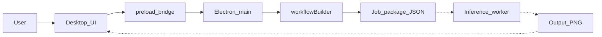

# System architecture at 70% (review copy)

**Caption for the supervisor.** At 70%, the desktop client can assemble a **complete inference job**: two images (wireframe + optional style) and a filled ComfyUI prompt (nodes 370 / 371 / 377 / 368). A generic **Inference worker** would run that job on a GPU and return a PNG. This review **does not** include a named cloud vendor, API keys, endpoint IDs, or `.env` setup. Connecting a specific hosted GPU is the remaining stage.

Use [`system-architecture.md`](system-architecture.md) only when the full product (including the cloud adapter) is in scope.

## Scope of this diagram

**In (implemented and shown):** window chrome, three columns, import/preview, prompt and presets, Electron IPC, `buildWorkflowPayload`, job JSON shape.

**Out (not shown this week):** vendor login, credential files, endpoint identifiers, live GPU polling.

## 70% data flow

Dashed arrows: **intended** path through the inference worker; not demonstrated with vendor configuration in this review.

## Components shown at 70%

| Component | What it does | Key functions |
|-----------|----------------|---------------|
| Desktop UI | Collect drawing, style, instruction, sampler | `bootstrap`, `setupDropzone`, `createMultiSelect`, `handleGenerate`, `setStatus` |
| Preload bridge | Safe calls from the page to the OS process | `generateRender`, `exportImage`, `getConfig`, `windowControl` |
| Electron main | Owns the window; receives Generate | `createWindow`, IPC `trigger-generation` |
| workflowBuilder | Fills the frozen graph | `loadBaseWorkflow`, `assemblePrompt`, `buildWorkflowPayload` |
| Job package | JSON the worker understands | `workflow` + `images[]` names `reimagine_base.png` / `reimagine_style.png` |
| Inference worker | GPU image-edit (black box) | Accepts job, returns PNG — **implementation deferred** |

## Frozen graph (explainable without ComfyUI)

| User input | Node | Meaning |
|------------|------|---------|
| Wireframe | 370 | “This is the building drawing.” |
| Style photo (optional) | 371 | “Match this look.” |
| Prompt + chips | 377 | “Do this in words.” |
| Steps / CFG / sampler / seed | 368 | How many refinement steps and how strongly to follow the prompt |

Defaults if Advanced is left alone: 4 steps, CFG 1.0, Euler, random seed.

## Workflow anyone can follow

**Goal.** Preview a photorealistic image from an architectural drawing without modelling the building in 3D.

1. **Open the app.** The title is Reimagine Render Engine. Three panels: instructions on the left, drawing in the middle, result on the right.
2. **Put the drawing in Input.** PNG, JPG, or WEBP. The filename and pixel size appear under the image.
3. **Optionally add a style photo** (a real interior, a material board, a finished render you like).
4. **Describe the change** in Texture Prompt (for example, concrete and warm evening light). Add style / tag / lighting chips if useful.
5. **Generate.** The app does **not** invent a new graph. It copies your files and text into the four slots above and builds one **job package**.
6. **Inference worker (next stage).** A GPU process would take that package, run the image-edit model, and send back a picture. At 70% you can show the package (mapped JSON in the 50% snapshot, or explain the same step in the 70% client). You are **not** logging into a cloud console in this review.
7. **When a worker is attached (100%).** The picture appears under Output. Export saves a PNG. History stores recent previews.

If Generate is blocked (30% snapshot), only steps 1–4 apply. If mapping-only (50% snapshot), step 5 writes JSON and stops.

## How to speak this in one minute

“The user prepares a drawing and a wish-list. The desktop app packages that into a standard image-edit job. Seventy percent of the project is that client and that package. The last thirty percent is plugging the package into a GPU worker. We are not presenting vendor credentials today.”

## Related files

- Snapshot without GPU: `progress/50-workflow-mapping/` (writes mapped JSON).
- Snapshot with worker attached: repository root (not this review).
- Papers: [`literature-survey.md`](literature-survey.md).
- Weekly log: [`logbook-8-weeks.md`](logbook-8-weeks.md).
