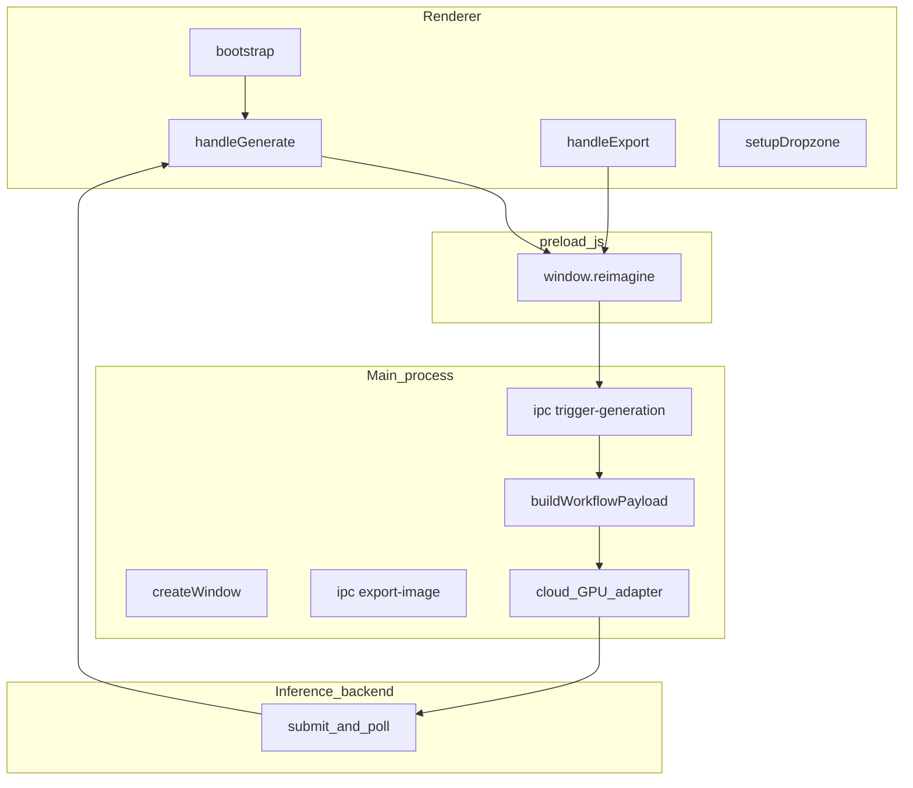

# System architecture (full product)

This document describes the **complete** Reimagine Render Engine: desktop UI, secure bridge, main process, workflow mapping, and the cloud GPU adapter used in the repository root. For the review that **must not** show vendor configuration, use [`system-architecture-70.md`](system-architecture-70.md) instead.

## What the system is

A Windows **Electron** desktop app. The user supplies an architectural wireframe, an optional style photograph, and a short instruction. The app fills a **fixed ComfyUI graph** and sends that job to a **cloud GPU adapter**, which returns a PNG to the Output panel.

The graph IDs are frozen: **370** base image, **371** style image, **377** text encode, **368** sampler.

## Layers

| Layer | Path | Role |
|-------|------|------|
| Renderer | `src/renderer/` | Three-column UI, file import, Generate / Export |
| Preload | `preload.js` | Isolated API `window.reimagine` (no Node in the page) |
| Main | `main.js` | Windows, IPC handlers, orchestrates mapping + inference |
| Workflow mapping | `src/services/workflowBuilder.js` | Injects UI values into `workflow-api.json` |
| Cloud GPU adapter | `src/services/runpodClient.js` | Submit job, poll until image or failure |
| Graph assets | `workflows/` | UI export + API prompt (`convert-workflow.js`) |

## Data flow



## Components and functions

### Renderer (`src/renderer/renderer.js`)

| Function | Responsibility |
|----------|----------------|
| `bootstrap` | Wires chips, dropzones, buttons, status from config |
| `setupDropzone` | Click / drop / clear; stores image as data URL |
| `fileToBase64` | File → data URL for IPC |
| `createMultiSelect` | Style / tags / lighting chips |
| `handleGenerate` | Builds payload, calls `generateRender`, shows PNG |
| `handleExport` | Calls `exportImage` with current output |
| `setStatus` | Status bar text and tone |
| `showOutput` / `addToHistory` / `renderHistory` | Output canvas and strip |
| `setupControlsToggle` | Simple vs Advanced |
| `setupWindowControls` | Min / max / close |

HTML layout: `src/renderer/index.html` (title **Reimagine Render Engine** only). Styles: `src/renderer/styles.css`.

### Preload (`preload.js`)

Exposed as `window.reimagine`:

| Method | IPC channel |
|--------|-------------|
| `generateRender` | `trigger-generation` |
| `exportImage` | `export-image` |
| `getConfig` | `get-config` |
| `openRendersFolder` | `open-renders-folder` |
| `windowControl` | `window-control` |
| `onGenerationProgress` | `generation-progress` |

### Main process (`main.js`)

| Function / handler | Responsibility |
|--------------------|----------------|
| `createWindow` | Frameless 1440×900 window, preload, `index.html` |
| `createSplash` / `startEngineThenReveal` | Optional local-engine splash (not required for the cloud path) |
| `hasRunPodConfig` / `resolveBackend` / `createRenderClient` | Chooses cloud GPU adapter vs local Comfy when configured |
| `trigger-generation` | Validates base image, `buildWorkflowPayload`, `client.generate` |
| `export-image` | Save-dialog PNG under Pictures / Reimagine Renders |
| `stripDataUrlPrefix` | Data-URL → raw base64 |

### Workflow mapping (`src/services/workflowBuilder.js`)

| Function | Responsibility |
|----------|----------------|
| `loadBaseWorkflow` | Reads `workflows/workflow-api.json` |
| `assemblePrompt` | Lead sentence + presets + tags + lighting + textarea |
| `applyModelOverrides` | Optional UNet/VAE filenames from env |
| `buildWorkflowPayload` | Writes nodes 370, 371, 377, 368; returns `{ workflow, seed, prompt }` |
| `randomSeed` | If the user left seed empty |

### Cloud GPU adapter (`src/services/runpodClient.js`)

Described here as the **hosted inference client** (full product only):

| Function | Responsibility |
|----------|----------------|
| `submitJob` | POST job `{ workflow, images[] }` |
| `getJobStatus` | Poll job state |
| `extractOutputImage` | Find base64 PNG in the response |
| `pollUntilComplete` | Until COMPLETED, FAILED, CANCELLED, or timeout |
| `generate` | Submit then poll |

### Convert script (`scripts/convert-workflow.js`)

Turns a ComfyUI UI export (`workflow.json`) into the API prompt (`workflow-api.json`), keeping the graph reachable from node **370**.

## Job package (full system)

```json
{
  "input": {
    "workflow": { "...": "ComfyUI API prompt" },
    "images": [
      { "name": "reimagine_base.png", "image": "<base64>" },
      { "name": "reimagine_style.png", "image": "<base64>" }
    ]
  }
}
```

Sampler defaults: 4 steps, CFG 1.0, `euler`, random seed.

## Plain-language workflow

1. The user drops a wireframe on **Input** and optionally a style photo on the left; they type what should change (materials, lighting, mood).
2. The page keeps those files and fields in memory (`bootstrap` / dropzones / chips).
3. **Generate** sends them through `preload` into the main process.
4. Main fills the prepared node graph (drawing, style, text, sampler).
5. The cloud GPU adapter runs the job and waits for a finished image.
6. The PNG appears on **Output**; **Export** writes a file. History keeps recent results.

## What is *not* a research contribution

Electron, ComfyUI, and the hosted GPU platform are **implementation**. The architecture’s academic story is instruction- and reference-conditioned **image-to-image** editing on a documented graph (see [`literature-survey.md`](literature-survey.md)).
