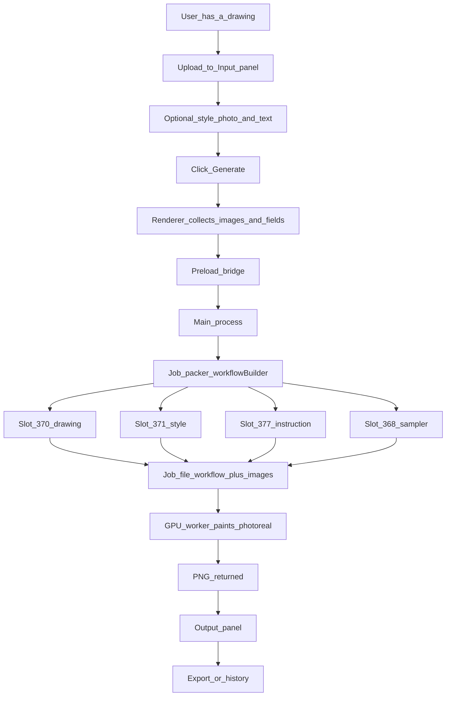
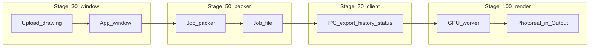

# Rendering workflow graph

End-to-end path from drawing to photoreal output. Boxes are software steps, not PowerPoint slides.

## Main graph

## Where each implementation stage sits

## Same graph in one line

User drawing → Input panel → Generate → Renderer → Preload → Main → Job packer (370, 371, 377, 368) → Job file → GPU worker → PNG → Output → Export

Stage 30 stops after the window. Stage 50 stops after the job file. Stage 70 is the full client ready to send that file. Stage 100 is the worker returning the photoreal PNG.
