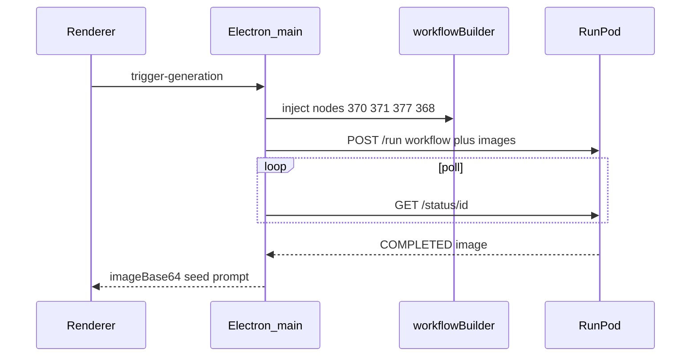

# 70% — RunPod generate

**What this milestone proves:** the production pipeline end-to-end: map UI → ComfyUI API prompt → RunPod `POST /run` → poll `/status/{id}` → show PNG → export.

**Copied from:** repository root `runpodClient.js`, `workflowBuilder.js`, and renderer. Local ComfyUI is omitted so the capstone story stays on RunPod.



## Environment

```bash
cd progress/70-runpod-generate
npm install
cp .env.example .env
# set RUNPOD_API_KEY and RUNPOD_ENDPOINT_ID
npm start
```

Failure modes (same as the final app): missing keys, job `FAILED`/`CANCELLED`, poll timeout (`POLL_TIMEOUT_MS`, default 10 minutes).

## Intentionally missing vs 100%

- Local ComfyUI backend / splash auto-start
- Windows installer (`electron-builder`)
- Course literature survey and packaging polish (those live at 100% / repo root)

**Previous:** [`../50-workflow-mapping`](../50-workflow-mapping) · **Final:** [repository root](../../) · notes: [`../100-final`](../100-final)
